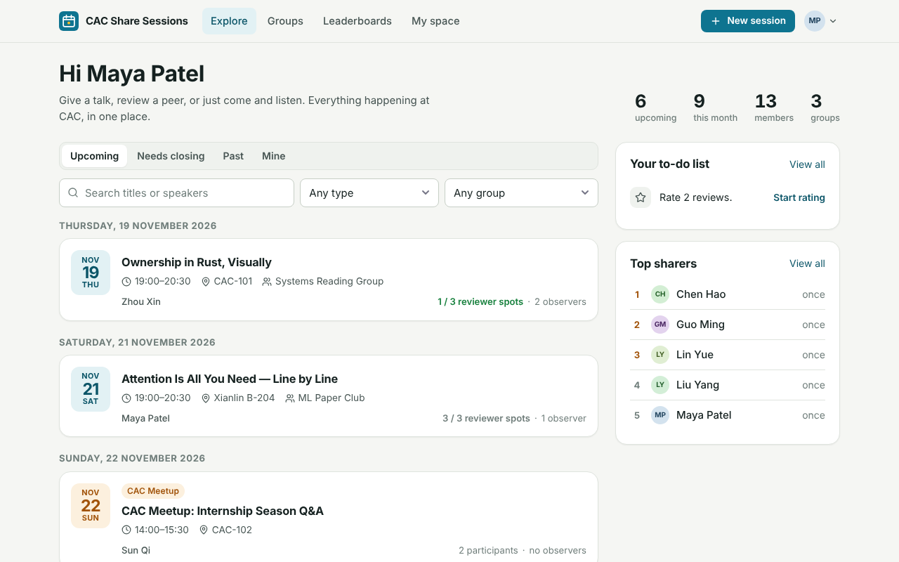
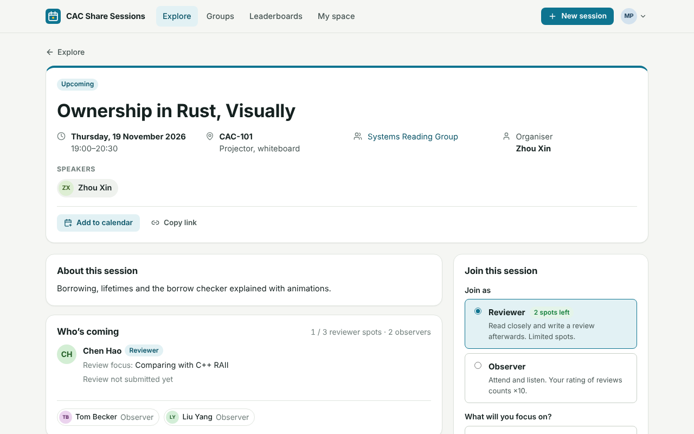
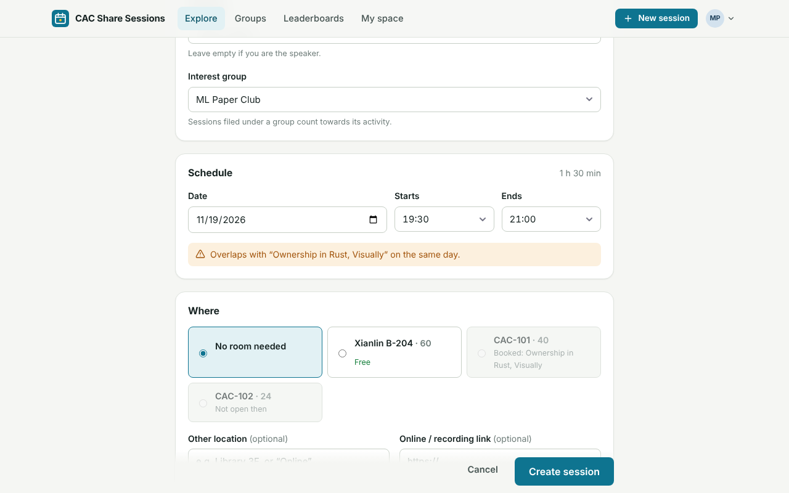
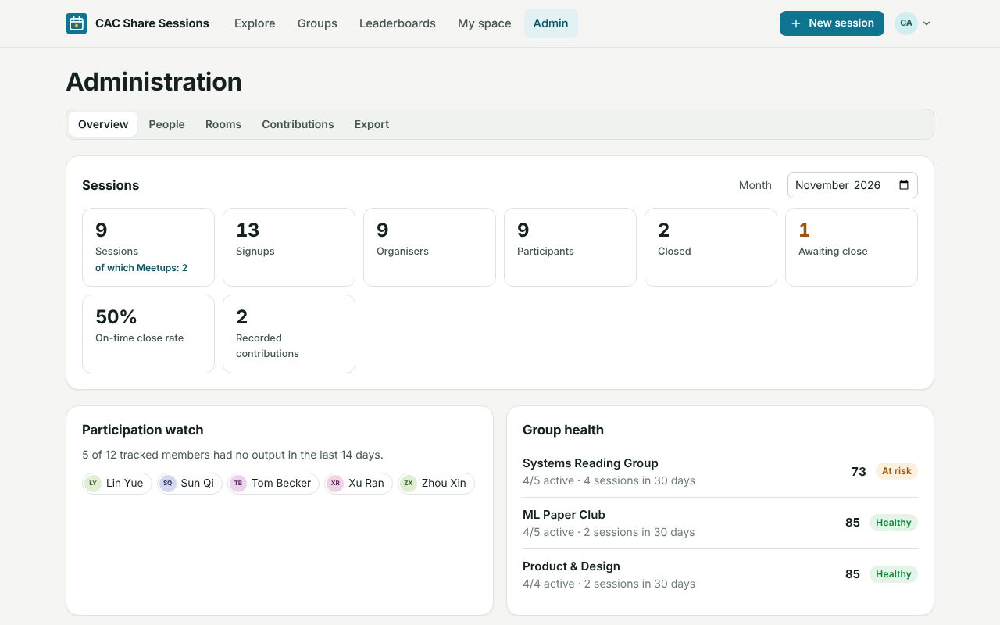
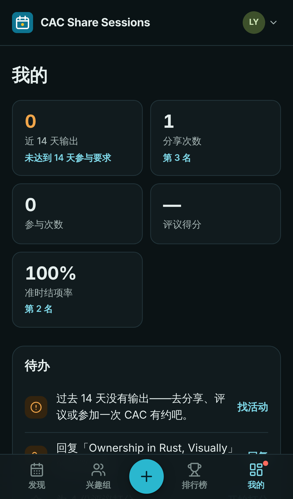

# CAC Share Sessions

Plan share sessions, find a free room, sign up as a reviewer or observer, rate each other's reviews, and keep an interest group active. All of it lives in one place for the CAC community.

> **中文简介：** CAC 分享会平台，用于发起分享、预订教室、报名评议 / 旁听、为评议打分，以及管理兴趣组。界面支持中英文切换。

| Explore | Session |
|---|---|
|  |  |
| **Planning a session** | **Admin overview** |
|  |  |

<p align="center"></p>

## What it does

**For members**
- **Explore** upcoming, live, past and your own sessions, grouped by day, with search and filters.
- **Sign up** as a *reviewer* (limited spots, with a review focus), an *observer*, or a *participant* at CAC Meetups. You can cancel until the session starts.
- **Review and rate.** Reviewers link their write-up once a session closes. Everyone else rates reviews 1–10, and ratings from the session's observers count ×10.
- **Invitations.** Organisers and speakers can invite a specific person to review. Signing up accepts the invitation automatically.
- **Interest groups.** Create one with at least one other person, join, leave, and hand over leadership.
- **My space** shows a prioritised to-do list (reviews due, sessions to close, invitations, inactivity), your numbers and ranks, and recommendations.
- **Leaderboards** for talks given, sessions joined, review quality and on-time closing, over all time or the last 30/90 days.
- **Add to calendar** (.ics), email notifications, English and 简体中文, and light and dark themes on both phone and desktop.

**For organisers**
- A session form that checks the schedule live. It shows which rooms are open and free for the exact time, blocks same-type room double-bookings, and warns about overlaps before you save.
- CAC Meetups are restricted to their weekly window (Sunday 14:00–18:00 by default).
- **Closing** a session records whether it closed on time (within 24 h by default) and reminds reviewers to submit.

**For administrators**
- A dashboard with the monthly report, a participation watch (members with no output in 14 days), group health scores, a reviewer watch, and schedule clashes.
- People management: roles, deactivation, participation tracking, and one-time set-password links.
- Rooms and their bookable open times, with weekly repeats.
- Manually recorded contributions, and CSV export of sessions and signups.

**Behind the scenes**, a worker sends queued email and runs the periodic jobs: daily review reminders and the weekly participation report.

## Architecture

```text
frontend/   Vue 3 + TypeScript + Vite, Pinia, vue-i18n — custom design system, no UI framework
backend/    FastAPI + SQLAlchemy 2 + Alembic — SQLite for development, MySQL or PostgreSQL in production
  app/api/        HTTP routes (OpenAPI docs at /api/docs)
  app/services/   business rules: activities, signups, invites, groups, rooms, stats, mail, jobs
  app/models.py   relational schema
  app/legacy.py   importer for data from the previous version
deploy/     systemd units, nginx config, install script
```

The backend serves the built frontend, so production is a single web process plus one worker. Sessions use an httpOnly cookie, and passwords are hashed with Argon2. Every write that has a capacity limit (reviewer spots, room bookings) takes a row lock, so it stays correct across multiple workers.

## Running it locally

You'll need Python 3.11+ and Node.js 20+.

```bash
cd backend
python -m venv .venv && source .venv/bin/activate   # Windows: .venv\Scripts\activate
pip install -e ".[dev]"
python -m app.cli migrate
python -m app.cli seed-demo        # optional: realistic demo data
uvicorn app.asgi:app --reload      # API on http://127.0.0.1:8000
```

```bash
cd frontend
npm install
npm run dev                         # app on http://localhost:5173, proxies /api to the backend
```

With the demo data you can sign in as `admin@example.edu` or any member, such as `maya.patel@example.edu`, all with the password `password123`. Without demo data, create an administrator with:

```bash
python -m app.cli create-admin --email you@example.edu
```

Emails are written to the backend log until you configure SMTP. All settings live in [`backend/.env.example`](backend/.env.example).

## Tests

```bash
cd backend && pytest                       # 91 tests; also runs on MySQL/PostgreSQL via TEST_DATABASE_URL
cd frontend && npm test                    # unit tests, including translation completeness
cd frontend && npm run build && npx playwright test   # end-to-end, against a fresh demo database
```

CI runs the backend suite on SQLite, PostgreSQL and MySQL, then type-checking, unit tests, the build, and the end-to-end suite.

## Deploying

See **[docs/DEPLOYMENT.md](docs/DEPLOYMENT.md)** for Docker Compose and Ubuntu with systemd and nginx.
Upgrading from the previous version? See **[docs/UPGRADING.md](docs/UPGRADING.md)**. It covers how to import your existing data.

## License

No license has been chosen yet. Until one is added, all rights are reserved by the author.
